# System Design · พอดีพอร์ต (Pordee Port · US Stock Insight)

ที่มา: `USER-STORIES.md` (48 ข้อ) และ `REQUIREMENTS.md` (FR 60 · BR 57 · NFR 17) · ขั้นนี้ยังไม่เขียนโค้ดเว็บ

**วิธีอ่าน**

- ทุกแผนภาพเป็น Mermaid และ render เป็นภาพจริงไว้ที่ `design/<ชื่อ>.png` (ชื่ออยู่ในคอมเมนต์ `diagram:` เหนือแต่ละแผนภาพ)
- รหัส FR / BR อ้างจาก `REQUIREMENTS.md` · รหัส A-xx คือสมมติฐานเดิม · **D-xx** คือคำถามใหม่ที่เกิดจากการออกแบบ (ท้ายไฟล์)
- **เวลา 2 แบบ:** หน้าจอแสดงเวลาไทยเสมอ แต่กฎตลาดคิดด้วย **เวลานิวยอร์ก** (`America/New_York`) และ "วันซื้อขาย" (`trade_date`, `session_date`) เก็บเป็น **วันที่ของนิวยอร์ก** เพื่อให้ช่วงเวลาออมแสงและการข้ามเที่ยงคืนของไทยไม่ต้องมีกรณีพิเศษ
- พอร์ต: เว็บ **3300** · ฐานข้อมูล **5434** (ไม่ใช้ 3000 / 5433 ของบทต้นฉบับ เพราะเครื่องนี้มี container `petshop` ใช้พอร์ต 3000 อยู่)

---

## 1. System Architecture

<!-- diagram: architecture -->
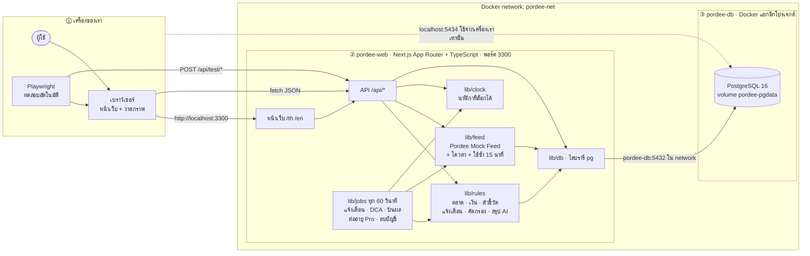

| ชั้น | อยู่ที่ไหน | หน้าที่ | ทดสอบด้วยอะไร |
|---|---|---|---|
| หน้าเว็บ | เบราว์เซอร์ (โค้ดจาก pordee-web) | แสดงผล 2 ภาษา วาดกราฟจากตัวเลขที่ API ส่งมา ไม่คิดเงินเอง | Playwright E2E บน Chromium และ Pixel 7 |
| สลับภาษา · ขยายตัวหนังสือ · สลับราคาปรับ/ราคาจริง | เบราว์เซอร์ (ค่าตั้งเก็บที่เซิร์ฟเวอร์ผ่าน API) | เปลี่ยนการแสดงผลเท่านั้น | Playwright ตรวจ `font-size` และข้อความ |
| API | pordee-web | รับคำขอ ตรวจสิทธิ์ เรียกกฎ อ่านเขียนฐานข้อมูล | Playwright `request` ยิงตรง |
| lib/rules | pordee-web | กฎทุกข้อที่มีตัวเลข: สถานะตลาด เงิน (decimal.js + NUMERIC) ตัวชี้วัด แจ้งเตือน คัดกรอง สรุป AI แบบกฎตายตัว | unit test (vitest) ตามตารางค่าขอบ BR |
| lib/feed | pordee-web | แหล่งข้อมูลจำลอง โควตา 5/60 วินาที และ 500/วัน การใช้ซ้ำ 15 นาที ป้ายข้อมูลไม่อัปเดต | unit test + `POST /api/test/feed` สั่งให้ส่ง $0 / ไม่ตอบ |
| lib/jobs | pordee-web | งานตามเวลา ทุก 60 วินาที · ตอนนาฬิกาถูกล็อกจะหยุดเอง และรันผ่าน `POST /api/test/tick` แทน | Playwright: ล็อกนาฬิกา → tick → ตรวจกล่องแจ้งเตือน / อีเมลที่ส่ง |
| lib/clock | pordee-web | "ตอนนี้" ของทั้งเว็บ ล็อกและเลื่อนได้ถึงวินาที (NFR-14) | `POST /api/test/clock` |
| ฐานข้อมูล | pordee-db | เก็บทุกอย่าง และเป็นด่านสุดท้ายของกฎที่ชนกันได้ (CHECK · UNIQUE · advisory lock) | psql ยิงคำสั่งพร้อมกัน · ตรวจข้อมูลหลังทำรายการ |

**ทำไมเงินคิดที่เซิร์ฟเวอร์:** BR-39 ปัดครึ่งขึ้นเป็นเซนต์ ถ้าคิดด้วยทศนิยมลอยตัวใน JavaScript `1.005` จะกลายเป็น `1.00` (ผิด) เงินทุกตัวจึงคิดด้วย decimal.js และเก็บเป็น NUMERIC ซึ่งทดสอบแล้วใน PostgreSQL 16: `round(670.00*0.0015, 2) = 1.01`

---

## 2. Use Case

<!-- diagram: usecase -->
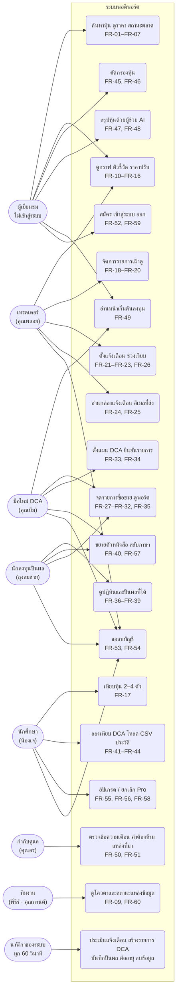

---

## 3. Flowchart

### 3.1 ขอราคาหุ้น 1 ตัว (ใช้ทุกที่ที่มีราคา)

<!-- diagram: flow-quote -->
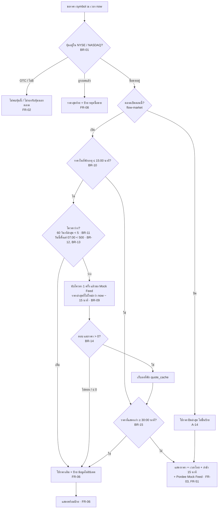

### 3.2 สถานะตลาด

<!-- diagram: flow-market -->
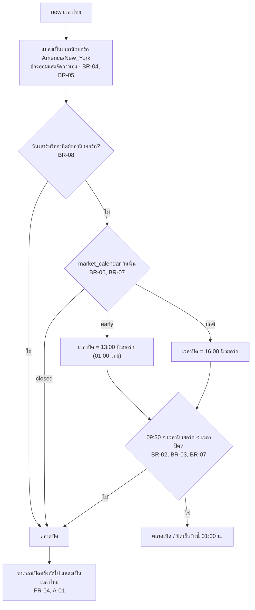

### 3.3 ประเมินแจ้งเตือน (ทุกรอบของ jobs)

<!-- diagram: flow-alert -->
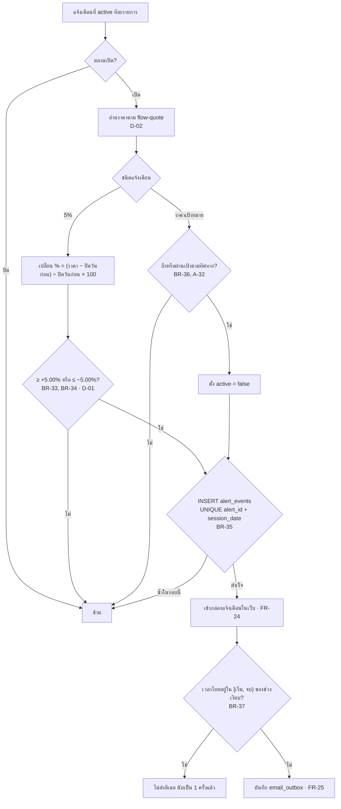

### 3.4 บันทึกรายการซื้อขายและคิดพอร์ต

<!-- diagram: flow-portfolio -->
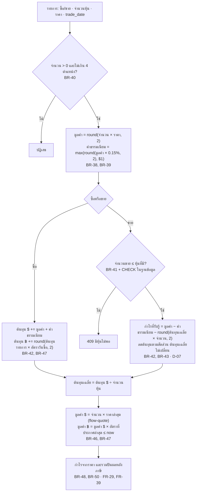

### 3.5 สร้างรายการ DCA รอยืนยัน

<!-- diagram: flow-dca -->
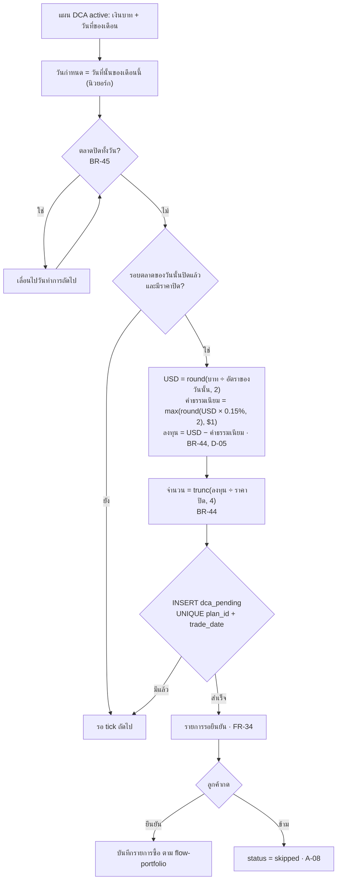

### 3.6 สิทธิ์ตามระดับสมาชิก

<!-- diagram: flow-entitlement -->
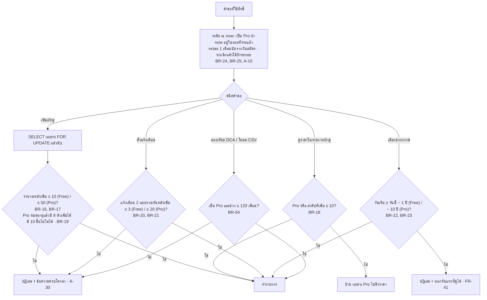

### 3.7 ตัวชี้วัดบนกราฟ

<!-- diagram: flow-indicators -->
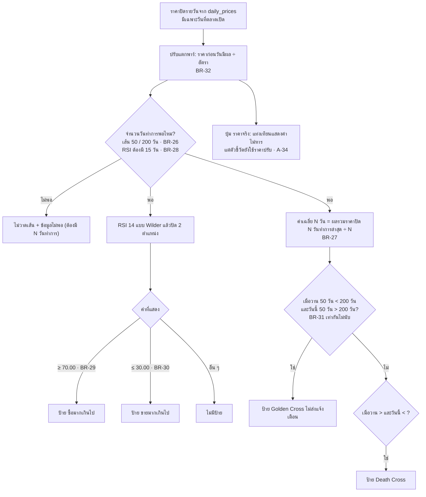

### 3.8 คัดกรอง เทียบหุ้น ประวัติ และสรุป AI

<!-- diagram: flow-study -->
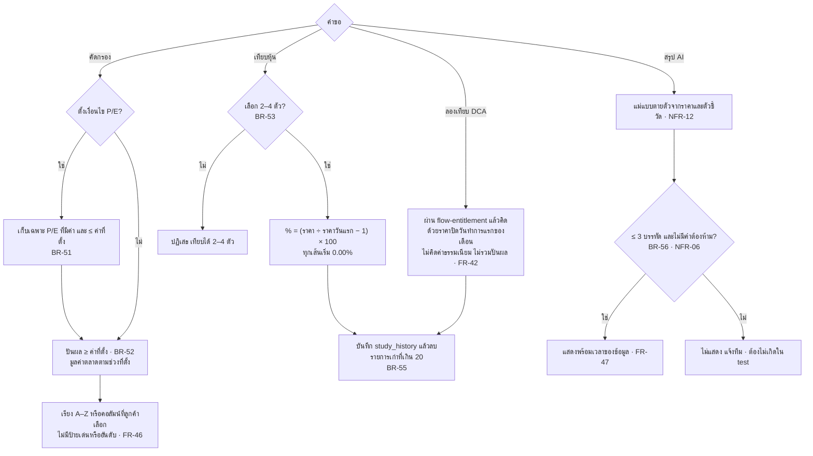

### 3.9 ปันผลเข้าพอร์ต

<!-- diagram: flow-dividend -->
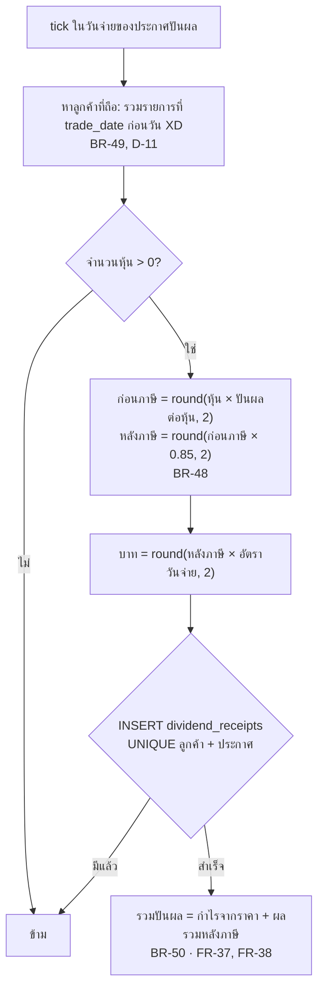

### 3.10 ลบบัญชี

<!-- diagram: flow-delete -->
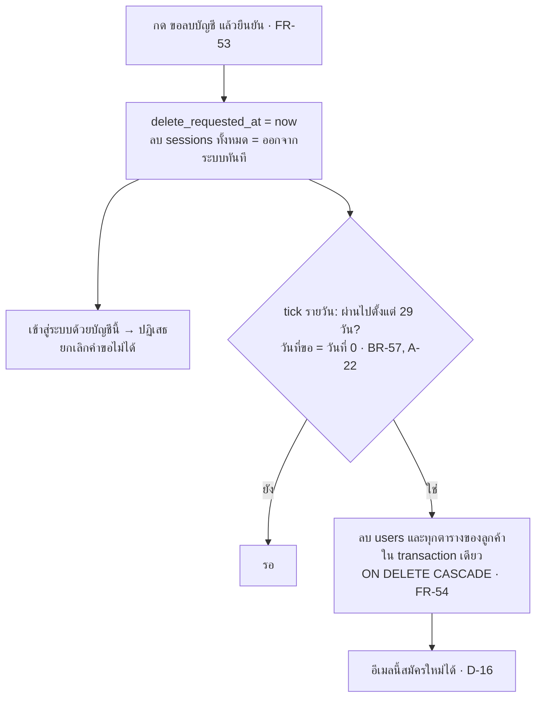

---

## 4. ERD

<!-- diagram: erd -->
```mermaid
erDiagram
  users ||--o{ sessions : "เข้าสู่ระบบ"
  users ||--o{ subscriptions : "สมัคร Pro"
  users ||--o{ watchlist_items : "เฝ้าดู"
  users ||--o{ alerts : "ตั้ง"
  users ||--o{ transactions : "จด"
  users ||--o{ holdings : "ถือ"
  users ||--o{ dca_plans : "ตั้งแผน"
  users ||--o{ dividend_receipts : "ได้รับ"
  users ||--o{ study_history : "ลอง"
  users ||--o{ email_outbox : "ได้อีเมล"
  stocks ||--o{ daily_prices : "ราคารายวัน"
  stocks ||--o{ intraday_quotes : "ราคาจำลองระหว่างวัน"
  stocks ||--o{ splits : "แตกพาร์"
  stocks ||--o{ dividends : "ประกาศปันผล"
  stocks ||--o| quote_cache : "ราคาที่พัก"
  stocks ||--o| feed_overrides : "สั่งทดสอบ"
  stocks ||--o{ watchlist_items : ""
  stocks ||--o{ alerts : ""
  stocks ||--o{ transactions : ""
  stocks ||--o{ holdings : ""
  alerts ||--o{ alert_events : "เกิด"
  alert_events ||--o| email_outbox : "ส่ง"
  dca_plans ||--o{ dca_pending : "สร้าง"
  dca_pending |o--o| transactions : "ยืนยันเป็น"
  dividends ||--o{ dividend_receipts : "จ่ายให้"

  users {
    int id PK
    text email UK
    text password_hash
    text tier "free / pro"
    bool is_staff
    date pro_period_end "null = ไม่เคย Pro"
    bool pro_auto_renew
    bool big_font
    text lang "th / en"
    time quiet_start
    time quiet_end
    timestamptz delete_requested_at
  }
  sessions {
    text token PK
    int user_id FK
    timestamptz expires_at
  }
  subscriptions {
    int id PK
    int user_id FK
    date period_start
    date period_end
    numeric amount_thb "10,2 = 199.00"
    timestamptz cancelled_at
  }
  stocks {
    text symbol PK "BRK.B"
    text name
    text exchange "NYSE / NASDAQ / OTC"
    text kind "stock / etf / reit"
    text status "listed / delisted"
    numeric pe "10,2 null = ไม่มี"
    numeric div_yield_pct "6,2"
    numeric market_cap_usd "20,0"
    text div_frequency
    date fundamentals_date
  }
  daily_prices {
    text symbol PK, FK
    date trade_date PK "วันที่นิวยอร์ก"
    numeric open "14,4"
    numeric high "14,4"
    numeric low "14,4"
    numeric close "14,4 ราคาจริงไม่ปรับ"
    bigint volume
  }
  splits {
    text symbol PK, FK
    date effective_date PK
    int ratio_to "10"
    int ratio_from "1"
  }
  dividends {
    int id PK
    text symbol FK
    date xd_date
    date pay_date
    numeric amount_per_share "10,4"
  }
  market_calendar {
    date ny_date PK
    text status "closed / early"
    time close_time_ny "13:00 เมื่อ early"
  }
  intraday_quotes {
    text symbol PK, FK
    timestamptz quote_time PK
    numeric price "14,4"
  }
  feed_overrides {
    text symbol PK, FK
    text mode "price / zero / timeout"
    numeric price "14,4"
  }
  quote_cache {
    text symbol PK, FK
    numeric price "14,4"
    timestamptz quote_time "เวลาของราคา"
    timestamptz fetched_at "เวลาที่ดึง"
  }
  feed_requests {
    bigint id PK
    timestamptz requested_at "นับโควตา"
    text symbol
    bool ok
  }
  fx_rates {
    date rate_date PK "วันทำการไทย"
    numeric mid_rate "10,4"
    timestamptz published_at "18:00"
  }
  watchlist_items {
    int user_id PK, FK
    text symbol PK, FK
    int position "ลำดับที่เพิ่ม"
    timestamptz added_at
  }
  alerts {
    int id PK
    int user_id FK
    text symbol FK
    text kind "pct / target"
    numeric target_price "14,4"
    text direction "up / down"
    bool active
  }
  alert_events {
    bigint id PK
    int alert_id FK "UNIQUE กับ session_date"
    date session_date "วันที่นิวยอร์กของรอบ"
    numeric price "14,4"
    numeric change_pct "9,4"
    timestamptz triggered_at
    bool in_quiet_hours
    timestamptz read_at
  }
  email_outbox {
    bigint id PK
    int user_id FK
    bigint alert_event_id FK
    text to_email
    text subject
    text body
    timestamptz sent_at
  }
  transactions {
    bigint id PK
    int user_id FK
    text symbol FK
    text side "buy / sell"
    date trade_date
    numeric shares "18,4"
    numeric price "14,4"
    numeric fee_usd "12,2"
    numeric fx_rate "10,4 วันซื้อ"
    text source "manual / dca"
  }
  holdings {
    int user_id PK, FK
    text symbol PK, FK
    numeric shares "18,4 CHECK >= 0"
    numeric cost_usd "14,2"
    numeric cost_thb "16,2"
    numeric realized_usd "14,2"
  }
  dca_plans {
    int id PK
    int user_id FK
    text symbol FK
    numeric amount_thb "12,2"
    smallint day_of_month
    bool active
  }
  dca_pending {
    bigint id PK
    int plan_id FK "UNIQUE กับ trade_date"
    date trade_date
    numeric close_price "14,4"
    numeric fx_rate "10,4"
    numeric usd_amount "12,2"
    numeric fee_usd "12,2"
    numeric shares "18,4"
    text status "pending / confirmed / skipped"
  }
  dividend_receipts {
    bigint id PK
    int user_id FK "UNIQUE กับ dividend_id"
    int dividend_id FK
    numeric shares "18,4"
    numeric gross_usd "12,2"
    numeric tax_usd "12,2"
    numeric net_usd "12,2"
    numeric fx_rate "10,4 วันจ่าย"
    numeric net_thb "14,2"
  }
  study_history {
    bigint id PK
    int user_id FK
    text kind "compare / backtest"
    jsonb params
    timestamptz created_at
  }
  app_clock {
    int id PK "แถวเดียว"
    timestamptz frozen_now "null = นาฬิกาจริง"
  }
```

**ชนิดข้อมูลเงิน:** ทุกคอลัมน์เงิน ราคา จำนวนหุ้น อัตรา และ % เป็น `NUMERIC` ไม่มี `float` · ราคา 4 ตำแหน่ง (`14,4`) เพราะราคาปรับแตกพาร์อาจมีเศษ · เงินดอลลาร์ 2 ตำแหน่ง (`12,2` / `14,2`) · จำนวนหุ้น `18,4` ตาม BR-40

**กฎที่ฐานข้อมูลกันไว้เป็นด่านสุดท้าย** (ลองกับ `postgres:16-alpine` ใน container ชั่วคราวแล้ว ผลอยู่ในส่วนที่ 6)

```sql
-- ขายเกินหุ้นที่มีไม่ได้ (BR-41) แม้ 2 คำขอมาพร้อมกัน
ALTER TABLE holdings ADD CONSTRAINT holdings_shares_nonneg CHECK (shares >= 0);
-- แจ้งเตือน 1 ครั้งต่อรอบตลาด (BR-35) และราคาเป้าหมายแจ้งครั้งเดียว (BR-36)
ALTER TABLE alert_events ADD CONSTRAINT one_per_session UNIQUE (alert_id, session_date);
-- รายการ DCA 1 รายการต่อแผนต่อวัน · ปันผล 1 ครั้งต่อคนต่อประกาศ
ALTER TABLE dca_pending ADD CONSTRAINT one_pending_per_day UNIQUE (plan_id, trade_date);
ALTER TABLE dividend_receipts ADD CONSTRAINT one_receipt UNIQUE (user_id, dividend_id);
-- จำนวนหุ้นในรายการต้องมากกว่า 0 (BR-40 ส่วนทศนิยมคุมด้วย NUMERIC(18,4) + ตรวจที่ API)
ALTER TABLE transactions ADD CONSTRAINT shares_pos CHECK (shares > 0);
```

```sql
-- โควตา 5 ครั้งใน 60 วินาที (BR-11) และ 500 ครั้งต่อวัน (BR-12, BR-13) ของทั้งเว็บ
-- ใช้ advisory lock ตัวเดียว ให้คำขอเข้าแถวทีละคำขอ แล้วนับ
BEGIN;
SELECT pg_advisory_xact_lock(4242);
INSERT INTO feed_requests(requested_at, symbol)
SELECT $now, $symbol
WHERE (SELECT count(*) FROM feed_requests WHERE requested_at > $now - interval '60 seconds') < 5
  AND (SELECT count(*) FROM feed_requests WHERE requested_at >= $quota_day_start) < 500
RETURNING id;   -- ไม่มีแถวกลับมา = โควตาเต็ม ใช้ราคาเดิม + ป้าย
COMMIT;
```

- จำนวนรายการเฝ้าดูและแจ้งเตือน (BR-16 ถึง BR-21) ตรวจใน transaction เดียวกับการเพิ่ม โดย `SELECT … FROM users WHERE id = $1 FOR UPDATE` ก่อนนับ เพื่อให้กดเพิ่มพร้อมกัน 2 แท็บแล้วไม่เกินโควตา
- `holdings` เป็นผลรวมของ `transactions` ที่อัปเดตใน transaction เดียวกัน เมื่อแก้หรือลบรายการเก่า (FR-28) จะคิด `holdings` ใหม่ทั้งหุ้นตัวนั้น
- ตารางนาฬิกา `app_clock` และ `feed_overrides` มีไว้ทดสอบเท่านั้น (NFR-14, NFR-15) เปิดใช้เมื่อ `ALLOW_TEST_API=1`

---

## 5. Sequence

### 5.1 คุณบีมเปิดหน้า VOO (ราคาเก่าเกิน 15 นาที ต้องขอใหม่)

<!-- diagram: seq-quote -->
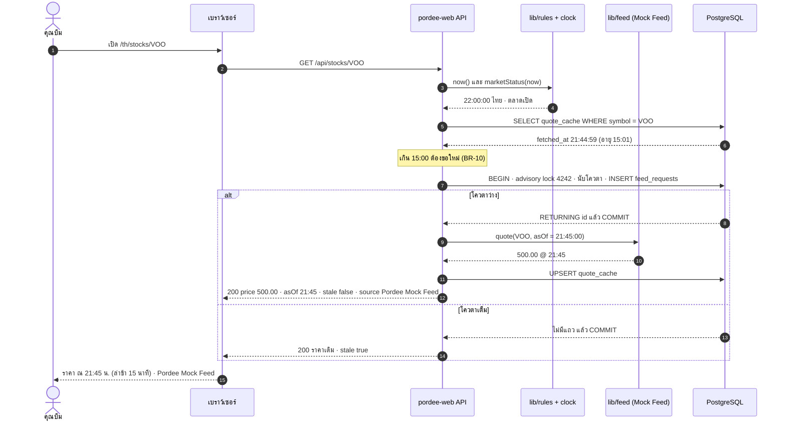

### 5.2 แจ้งเตือน AAPL ของคุณพลอยในช่วงเงียบ

<!-- diagram: seq-alert -->
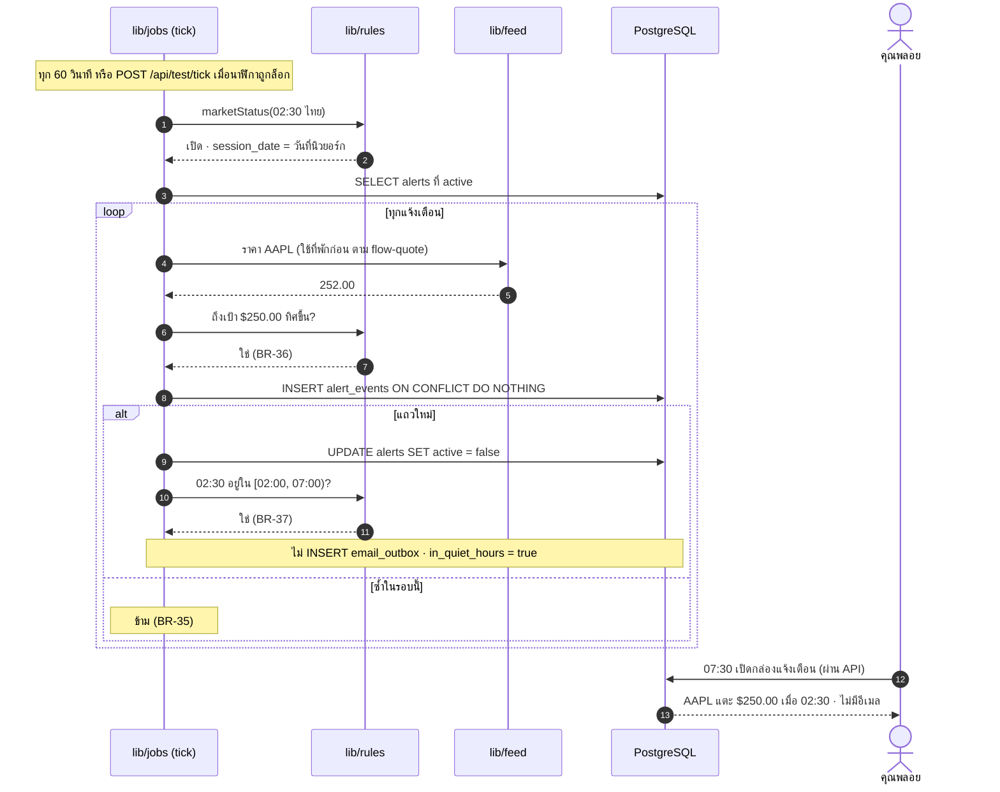

### 5.3 DCA ของคุณบีม: สร้างรายการรอยืนยัน แล้วกดยืนยัน 2 ครั้งเร็ว ๆ

<!-- diagram: seq-dca -->
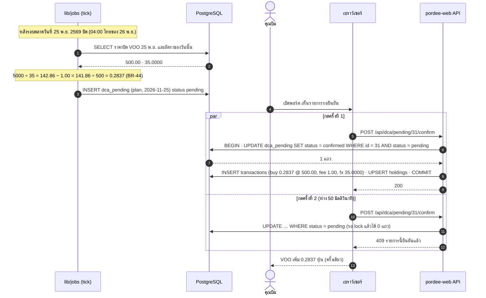

### 5.4 ขาย 20 หุ้นพร้อมกันจาก 2 แท็บ (มีอยู่ 20 หุ้น)

<!-- diagram: seq-race-sell -->
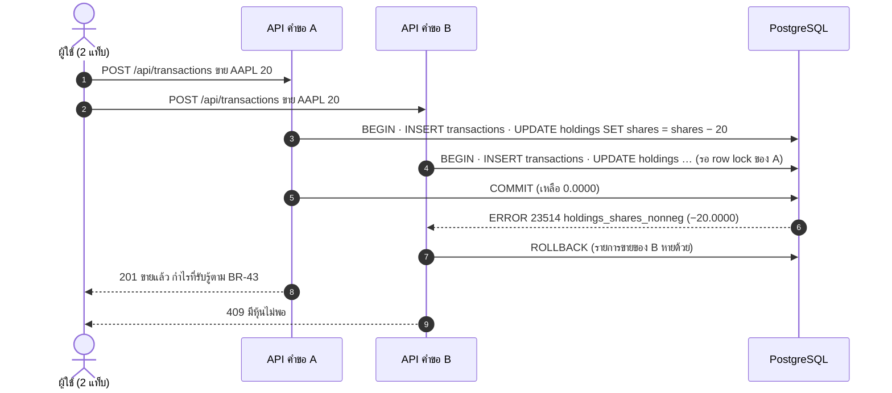

---

## 6. ผลการลองกลไกกับ PostgreSQL 16 จริง

ลองใน container ชั่วคราว `postgres:16-alpine` (ลบทิ้งแล้ว) ไม่ได้เขียนตามทฤษฎีอย่างเดียว

| ลองอะไร | ผล | ตรงกฎ |
|---|---|---|
| `round(670.00*0.0015, 2)` · `round(669.00*0.0015, 2)` · `greatest(round(666.00*0.0015, 2), 1.00)` | 1.01 · 1.00 · 1.00 | BR-38, BR-39 ✅ |
| `round(0.27*0.85, 2)` | 0.23 | BR-48 ✅ |
| `round(5000/35.00, 2)` · `trunc(141.86/500.00, 4)` · `trunc(141.86/141.87, 4)` | 142.86 · 0.2837 · 0.9999 | BR-44 ✅ |
| 2 transaction ขาย 20 หุ้นพร้อมกัน (มี 20) | A ถูกปฏิเสธด้วย `holdings_shares_check` · B สำเร็จ · เหลือ 0.0000 | BR-41 ✅ |
| INSERT `alert_events` (7, 2026-11-09) 2 ครั้ง | ครั้งที่ 2 `duplicate key … alert_events_alert_id_session_date_key` | BR-35 ✅ |
| ขอโควตาพร้อมกัน 8 คำขอ ด้วย advisory lock | ได้ 5 คำขอพอดี | BR-11 ✅ |

---

## 7. API ที่ได้จากการออกแบบ (ร่าง รายละเอียดจะอยู่ใน API-CONTRACT ตอน LAB 6)

| กลุ่ม | เส้นทาง |
|---|---|
| หุ้นและตลาด | `GET /api/stocks?q=` · `GET /api/stocks/:symbol` · `GET /api/stocks/:symbol/candles?interval=day\|week&from&to&adjusted=` · `POST /api/stocks/:symbol/summary` · `GET /api/market/status` |
| เฝ้าดูและแจ้งเตือน | `GET/POST/DELETE /api/watchlist` · `GET/POST/PATCH/DELETE /api/alerts` · `GET /api/inbox` · `GET /api/outbox` · `PATCH /api/me/quiet-hours` |
| พอร์ต | `GET /api/portfolio` · `GET/POST/PATCH/DELETE /api/transactions` · `GET/POST/PATCH /api/dca/plans` · `POST /api/dca/pending/:id/confirm\|skip` · `GET /api/dividends/calendar` |
| ศึกษา | `POST /api/screener` · `POST /api/compare` · `POST /api/backtest` · `GET /api/export.csv` · `GET /api/history` |
| บัญชี | `POST /api/auth/signup\|login\|logout` · `GET/PATCH /api/me` · `POST /api/billing/upgrade\|cancel` · `POST /api/account/delete` |
| ทีมงาน | `GET /api/staff/feed-status` |
| ทดสอบ (`ALLOW_TEST_API=1`) | `POST /api/test/reset {now?}` · `POST /api/test/clock {now}` · `POST /api/test/feed {symbol, mode, price?}` · `POST /api/test/tick` · `GET /api/health` |

---

## 8. คำถามที่ได้จากการออกแบบ

เรื่องที่ `USER-STORIES.md` และ `REQUIREMENTS.md` ยังไม่บอก การวาดแผนภาพทำให้เห็นเรื่องเหล่านี้ ทีมใช้สมมติฐานในคอลัมน์ขวาไปก่อน

| รหัส | เจอตอนวาด | คำถาม | สมมติฐานที่ใช้ | กระทบ |
|---|---|---|---|---|
| D-01 | flow-alert | % เปลี่ยนเทียบ 5.00% ด้วยค่าจริงหรือค่าที่แสดง 2 ตำแหน่ง · $209.99 จาก $200 = 4.995% ถ้าใช้ค่าที่แสดงจะได้ 5.00% แล้วแจ้ง ขณะที่ RSI ใช้ค่าที่แสดง (BR-29) | ใช้ค่าจริง ไม่ปัด $209.99 ไม่แจ้ง | BR-33, BR-34 |
| D-02 | flow-alert + โควตา | ระบบต้องเช็กแจ้งเตือนทุกนาที แต่โควตา 500 ครั้งต่อวัน ทั้งรอบตลาด 6.5 ชม. มี 26 ช่วง ช่วงละ 15 นาที จึงดึงราคาให้ทันได้แค่ราว **19 หุ้น** ทั้งเว็บ (500 ÷ 26) · K9 ยืนยันจากการออกแบบแล้วว่าโควตาไม่พอเมื่อมีลูกค้าจริง | แจ้งเตือนใช้ราคาในที่พักก่อน ขอใหม่เมื่อเกิน 15 นาทีและโควตาว่าง · หุ้นที่ไม่ได้ราคาใหม่ไม่ประเมิน | US-05, US-18, K9 |
| D-03 | flow-quote | ขอแหล่งข้อมูลแล้วไม่ตอบ นับเป็น 1 ครั้งของโควตาไหม | นับ เพราะแหล่งข้อมูลจริงนับ | BR-11, BR-12 |
| D-04 | ERD | "วันที่ 25" ของ DCA และ "วันซื้อ" หมายถึงวันของนิวยอร์ก (คืนวันที่ 25 ตามเวลาไทย) ใช่ไหม | ใช่ เก็บเป็นวันที่นิวยอร์ก | BR-45, BR-47 |
| D-05 | flow-dca | DCA ใช้อัตราแลกเปลี่ยนของวันไหน | อัตราของวันไทยที่ตรงกับวันซื้อขายนิวยอร์ก ซึ่งประกาศ 18:00 ก่อนตลาดเปิด | BR-44, BR-46 |
| D-06 | ERD `dca_plans` | ตั้งวันที่ 29–31 ได้ไหม เดือนที่ไม่มีวันนั้นทำอย่างไร | ตั้งได้ 1–28 เท่านั้น | FR-33 |
| D-07 | flow-portfolio | ขายบางส่วนแล้วต้นทุนบาทลดอย่างไร ปัดเศษตรงไหน | ลดตามสัดส่วนจำนวนหุ้น ปัด 2 ตำแหน่ง | BR-43, BR-47 |
| D-08 | flow-portfolio | แก้รายการเก่าจนทำให้ช่วงหนึ่งมีหุ้นติดลบ (ขายก่อนซื้อตามวันที่) ยอมไหม | ไม่ยอม ตรวจตามลำดับวันที่ทุกครั้งที่แก้ | FR-28, BR-41 |
| D-09 | flow-quote | ข้อมูลจำลองระหว่างวันมีราคาทุกกี่นาที ถ้าไม่มีราคา ณ เวลานั้นใช้อะไร | ใช้ราคาจุดล่าสุดที่ไม่ใหม่กว่า now − 15 นาที · `TEST-DATA.md` ต้องกำหนดจุดราคา | BR-09, NFR-15 |
| D-10 | Architecture | งานตามเวลาทำงานใน container เว็บ ถ้าเว็บปิดอยู่ตอนถึงเวลา DCA ต้องตามทำย้อนหลังไหม | ตามทำย้อนหลังทุกวันที่ยังไม่มีรายการ (UNIQUE กันซ้ำ) | FR-34, FR-37 |
| D-11 | ERD `dividend_receipts` | ปันผลบันทึกวันไหน ใช้จำนวนหุ้น ณ เวลาไหน | บันทึกในวันจ่าย ใช้จำนวนหุ้นจากรายการที่ trade_date ก่อนวัน XD | BR-49, A-09 |
| D-12 | ERD `splits` | หุ้นในพอร์ตตอนแตกพาร์ (A-23) ปรับที่ `transactions` หรือแค่ `holdings` | `transactions` เก็บค่าจริงตามที่จด · `holdings` และหน้าพอร์ตแสดงแบบปรับแล้ว | BR-32, A-23 |
| D-13 | flow-market | สัปดาห์ของแท่งรายสัปดาห์คือจันทร์–ศุกร์ของนิวยอร์ก และสัปดาห์ปัจจุบันที่ยังไม่จบแสดงไหม | ใช้สัปดาห์นิวยอร์ก แสดงแท่งที่ยังไม่จบด้วย | FR-10 |
| D-14 | Use Case | ค้นคำว่า "Apple" แล้วผลแรกต้องเป็น AAPL ใช้กฎเรียงอะไร | ชื่อย่อตรงทั้งคำก่อน แล้วชื่อบริษัทขึ้นต้นด้วยคำค้น แล้ว A–Z | FR-01 |
| D-15 | Use Case | คุณอรต้องเป็นบัญชีทีมงานไหม (§10 มีแค่คุณกานต์) | คุณอรไม่ต้องมีบัญชีพิเศษ ตรวจจากหน้าเว็บปกติ | FR-60 |
| D-16 | ERD `users` | อีเมลของบัญชีที่ขอลบ สมัครใหม่ได้ทันทีไหม | ได้หลังข้อมูลถูกลบจริงเท่านั้น ระหว่างรอขึ้นว่าอีเมลถูกใช้แล้ว | BR-57 |
| D-17 | flow ต่ออายุ Pro | ต่ออายุอัตโนมัติด้วยการจ่ายจำลอง มีกรณีจ่ายไม่ผ่านไหม | จ่ายจำลองผ่านเสมอ | BR-24 |
| D-18 | seq-quote | ป้าย "ข้อมูลไม่อัปเดต" (BR-15) วัดอายุจากเวลาของราคา หรือเวลาที่ดึง | เวลาของราคา (`quote_time`) ซึ่งปกติเก่า 15 นาทีอยู่แล้ว | BR-15 |
| D-19 | Architecture | ข้อความสรุปของผู้ช่วย AI (แม่แบบภาษาไทยและอังกฤษ) ใครเขียนและใครอนุมัติ | ทีมเขียน คุณอรตรวจคำต้องห้ามก่อนขึ้นจริง | FR-47, NFR-06 |
| D-20 | seq-dca | ราคาปิดที่ใช้ใน DCA ถ้าคุณบีมยืนยันช้าไป 3 วัน ยังใช้ราคาปิดวันที่ 25 ไหม | ใช่ ราคาและอัตราล็อกตอนสร้างรายการ | FR-34 |

---

## 9. ความครอบคลุมของแผนภาพ

<!-- COVERAGE:START -->
สคริปต์อ่านรหัส FR / BR จากในแผนภาพเท่านั้น (ไม่นับข้อความรอบ ๆ) และขยายช่วง เช่น FR-01–FR-07

| แผนภาพ | ไฟล์ภาพ | FR | BR |
|---|---|---|---|
| architecture | `design/architecture.png` | — | — |
| usecase | `design/usecase.png` | FR-01, FR-02, FR-03, FR-04, FR-05, FR-06, FR-07, FR-09, FR-10, FR-11, FR-12, FR-13, FR-14, FR-15, FR-16, FR-17, FR-18, FR-19, FR-20, FR-21, FR-22, FR-23, FR-24, FR-25, FR-26, FR-27, FR-28, FR-29, FR-30, FR-31, FR-32, FR-33, FR-34, FR-35, FR-36, FR-37, FR-38, FR-39, FR-40, FR-41, FR-42, FR-43, FR-44, FR-45, FR-46, FR-47, FR-48, FR-49, FR-50, FR-51, FR-52, FR-53, FR-54, FR-55, FR-56, FR-57, FR-58, FR-59, FR-60 | — |
| flow-quote | `design/flow-quote.png` | FR-02, FR-03, FR-06, FR-08, FR-51 | BR-01, BR-09, BR-10, BR-11, BR-12, BR-13, BR-14, BR-15 |
| flow-market | `design/flow-market.png` | FR-04 | BR-02, BR-03, BR-04, BR-05, BR-06, BR-07, BR-08 |
| flow-alert | `design/flow-alert.png` | FR-24, FR-25 | BR-33, BR-34, BR-35, BR-36, BR-37 |
| flow-portfolio | `design/flow-portfolio.png` | FR-29, FR-39 | BR-38, BR-39, BR-40, BR-41, BR-42, BR-43, BR-46, BR-47, BR-48, BR-50 |
| flow-dca | `design/flow-dca.png` | FR-34 | BR-44, BR-45 |
| flow-entitlement | `design/flow-entitlement.png` | FR-41 | BR-16, BR-17, BR-18, BR-19, BR-20, BR-21, BR-22, BR-23, BR-24, BR-25, BR-54 |
| flow-indicators | `design/flow-indicators.png` | — | BR-26, BR-27, BR-28, BR-29, BR-30, BR-31, BR-32 |
| flow-study | `design/flow-study.png` | FR-06, FR-12, FR-42, FR-46, FR-47 | BR-51, BR-52, BR-53, BR-55, BR-56 |
| flow-dividend | `design/flow-dividend.png` | FR-37, FR-38 | BR-48, BR-49, BR-50 |
| flow-delete | `design/flow-delete.png` | FR-53, FR-54 | BR-57 |
| erd | `design/erd.png` | — | — |
| seq-quote | `design/seq-quote.png` | — | BR-10 |
| seq-alert | `design/seq-alert.png` | — | BR-35, BR-36, BR-37 |
| seq-dca | `design/seq-dca.png` | — | BR-44 |
| seq-race-sell | `design/seq-race-sell.png` | — | BR-43 |

**รวม:** แผนภาพ 17 รูป · FR 60/60 · BR 57/57

- FR ที่ยังไม่อยู่ในแผนภาพใดเลย: ไม่มี
- BR ที่ยังไม่อยู่ในแผนภาพใดเลย: ไม่มี
<!-- COVERAGE:END -->
