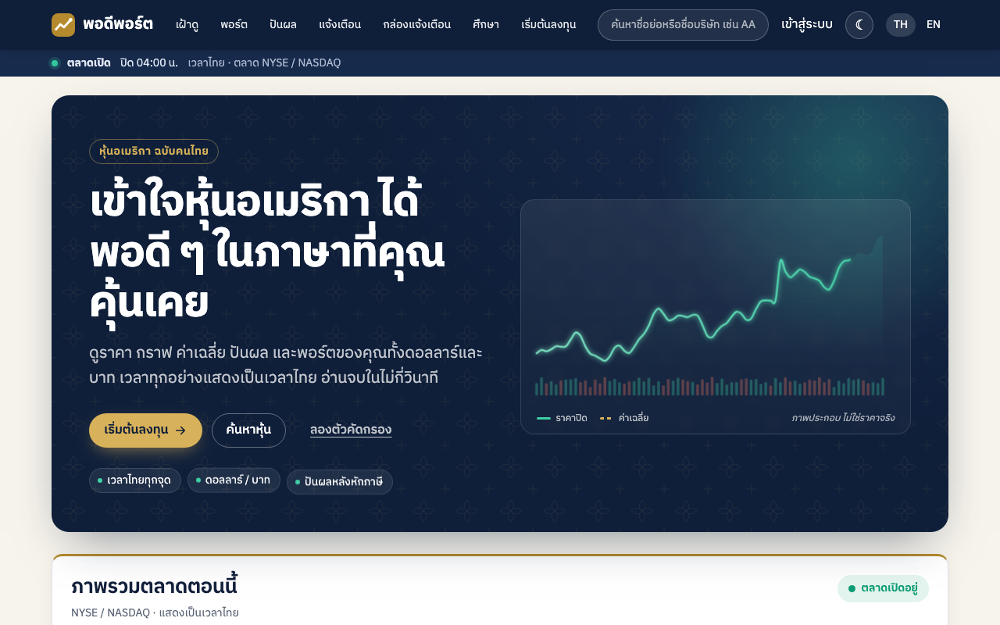
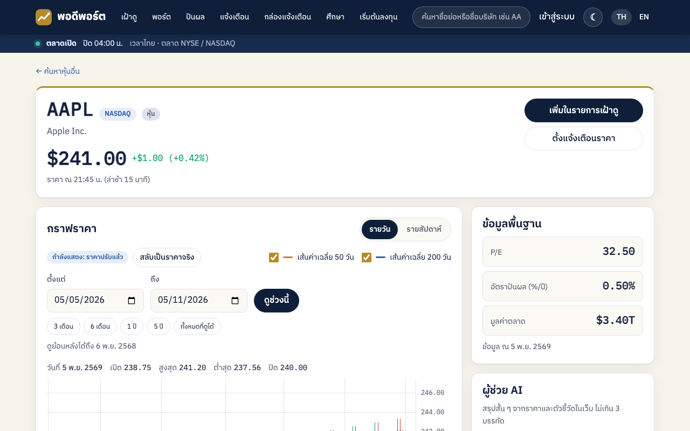
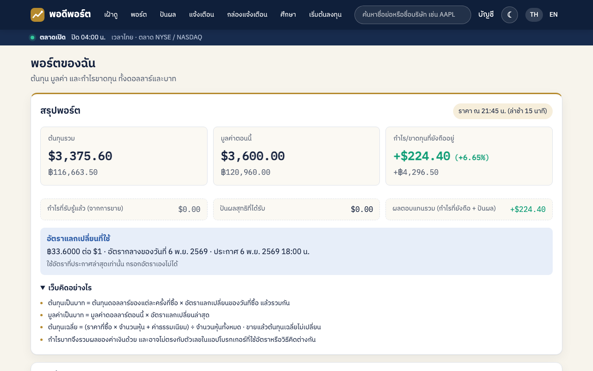
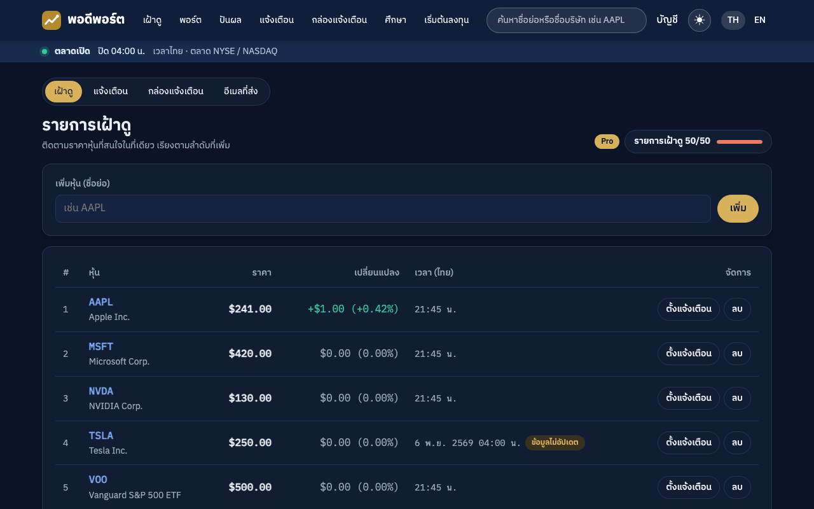
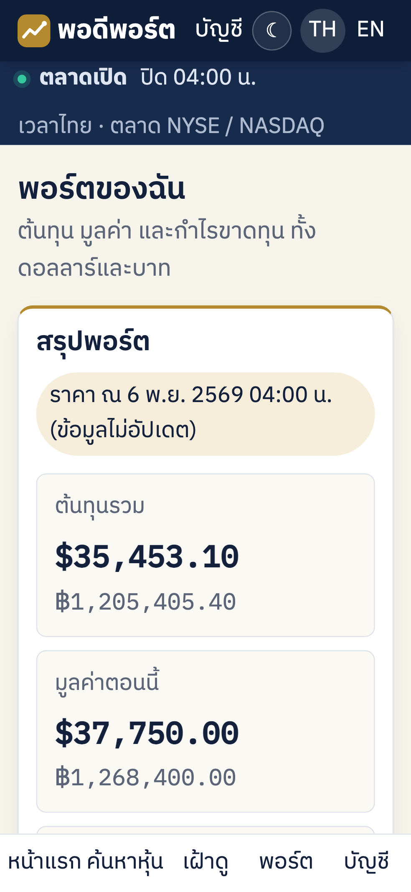
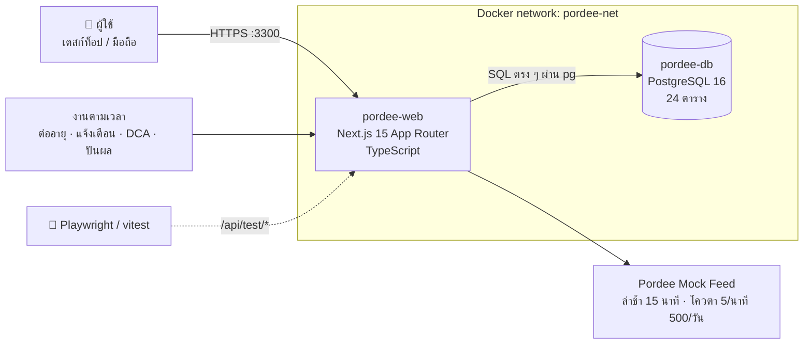
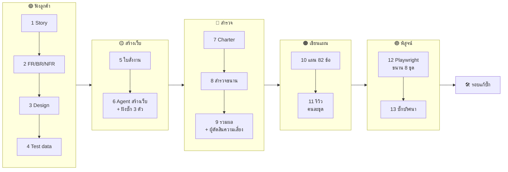

<div align="center">

# 📈 พอดีพอร์ต · Pordee Port

### เข้าใจหุ้นอเมริกาได้พอดี ๆ ในภาษาที่คุณคุ้นเคย

เว็บดูข้อมูลหุ้นอเมริกาเป็นภาษาไทยสำหรับนักลงทุนรายย่อย · สร้างจากบันทึกสัมภาษณ์ลูกค้า แล้วพิสูจน์ด้วยแผนทดสอบที่ tester เขียนเอง




</div>

> [!IMPORTANT]
> ข้อมูลเพื่อการศึกษา **ไม่ใช่คำแนะนำการลงทุน** · ราคามาจากแหล่งข้อมูลจำลอง "Pordee Mock Feed" ไม่ใช่ตลาดจริง · บุคคลในบันทึกสัมภาษณ์เป็นตัวละครสมมติ

---

## 📑 สารบัญ

1. [โปรเจกต์นี้คืออะไร](#-โปรเจกต์นี้คืออะไร)
2. [หน้าตาเว็บ](#-หน้าตาเว็บ)
3. [ฟีเจอร์](#-ฟีเจอร์)
4. [เริ่มใช้งานใน 3 นาที](#-เริ่มใช้งานใน-3-นาที)
5. [บัญชีตัวอย่าง](#-บัญชีตัวอย่าง)
6. [สถาปัตยกรรม](#️-สถาปัตยกรรม)
7. [เส้นทาง 13 LAB](#️-เส้นทาง-13-lab)
8. [ผลการทดสอบ](#-ผลการทดสอบ)
9. [บั๊กปริศนา](#-บั๊กปริศนา-lab-13)
10. [รันชุดทดสอบเอง](#-รันชุดทดสอบเอง)
11. [โครงโฟลเดอร์](#-โครงโฟลเดอร์)
12. [Skill สำหรับทำซ้ำ](#-skill-สำหรับทำซ้ำ)
13. [แก้ปัญหาที่พบบ่อย](#-แก้ปัญหาที่พบบ่อย)

---

## 💡 โปรเจกต์นี้คืออะไร

โปรเจกต์นี้ทำตามขั้นตอนบทเรียน 04 ของวิชา (`Teaching_CWN2026/00_week01/04_sabai-spa-web-and-testplan-from-interview`) ครบทุก LAB แต่เปลี่ยนโดเมนจากร้านสปาเป็น **เว็บดึงข้อมูลหุ้นอเมริกามาวิเคราะห์**

ประโยคหลักของบท:

> **"ลูกค้าขอ ≠ AI บอกว่าทำแล้ว ≠ เว็บทำจริง"**

เว็บนี้ AI สร้างเองทั้งหมด และ AI ก็รายงานว่าทำกฎครบ แต่งานของ tester คือ **พิสูจน์ ไม่ใช่เชื่อ** ผลรอบแรกจึงไม่ผ่านเกณฑ์ (47/82) จนต้องมีรอบแก้บั๊กทั้งเว็บ ก่อนจะผ่านครบ 82/82

| | ตัวเลข |
|---|---|
| 👥 บุคคลในบันทึกสัมภาษณ์ | 7 คน (นักลงทุนมือใหม่ เทรดเดอร์ วัยเกษียณ เจ้าของ ฯลฯ) |
| 📝 User Story | 48 (Must 18 · Should 20 · Could 10) |
| 📐 Requirement | FR 60 · BR 57 · NFR 17 |
| 🗺️ แผนภาพออกแบบ | 17 (ERD 24 ตาราง) |
| 🎯 ค่าขอบที่ต้องทดสอบ | E01–E157 |
| 🧪 Test case ในแผน | 82 (P1 52 · P2 28 · P3 2) |
| 🎞️ GIF หลักฐาน | 83 ไฟล์ |

---

## 📸 หน้าตาเว็บ

<table>
<tr>
<td width="50%"><br><sub><b>หน้าหุ้น</b> · ราคาล่าช้า 15 นาที เวลาไทย · กราฟแท่งเทียน · เส้นค่าเฉลี่ย · ข้อมูลพื้นฐาน</sub></td>
<td width="50%"><br><sub><b>พอร์ต</b> · ต้นทุน มูลค่า กำไร ทั้ง $ และ ฿ · อัตราแลกเปลี่ยนที่ใช้ · อธิบายวิธีคิด</sub></td>
</tr>
<tr>
<td><br><sub><b>รายการเฝ้าดู (โหมดมืด)</b> · ราคาเก่ามีป้าย "ข้อมูลไม่อัปเดต" พร้อมวันที่จริง</sub></td>
<td align="center"><br><sub><b>มือถือ 375px</b> · โหมดตัวหนังสือใหญ่ ≥ 20px</sub></td>
</tr>
</table>

---

## ✨ ฟีเจอร์

<details open>
<summary><b>🔎 หุ้นและราคา</b></summary>

- ค้นหาหุ้น 60 ตัวในตลาด NYSE / NASDAQ (ด้วยชื่อย่อหรือชื่อบริษัท · ไม่รับหุ้นนอกตลาด)
- ราคาล่าช้า 15 นาที แสดง**เวลาไทย** · ราคาที่ไม่ใช่รอบตลาดปัจจุบันมี**วันที่**กำกับเสมอ
- สถานะตลาดคิดตาม**เวลานิวยอร์ก** รองรับเวลาออมแสง วันหยุด และวันปิดเร็ว
- ป้าย **"ข้อมูลไม่อัปเดต"** เมื่อราคาเก่า ≥ 30 นาทีขณะตลาดเปิด · หุ้นถูกถอดแสดงราคาสุดท้ายพร้อมวันที่
- โควตาแหล่งข้อมูล 5 ครั้ง/60 วินาที และ 500 ครั้ง/วัน (วันใหม่เริ่ม 07:00) · งานแจ้งเตือนมีโควตาสำรองของตัวเอง
</details>

<details>
<summary><b>📊 กราฟและตัวชี้วัด</b></summary>

- แท่งเทียนรายวัน / รายสัปดาห์ · เลือกช่วงวันที่ (Free ย้อนหลัง 1 ปี · Pro ไม่จำกัด)
- เส้นค่าเฉลี่ย 50 / 200 วัน · RSI 14 วัน (Wilder) พร้อมป้าย "ซื้อมากเกินไป / ขายมากเกินไป"
- Golden Cross / Death Cross (เท่ากันไม่นับ) · ราคาปรับแตกพาร์ (NVDA)
</details>

<details>
<summary><b>🔔 เฝ้าดูและแจ้งเตือน</b></summary>

- รายการเฝ้าดู Free 10 · Pro 50 · เพิ่มหุ้นถูกถอดต้องยืนยันก่อน · ลบต้องยืนยัน
- แจ้งเตือนขยับ 5% (ครั้งเดียวต่อรอบตลาด) และราคาเป้าหมาย (ปิดตัวเองเมื่อถึง ไม่กินโควตาต่อ)
- **ช่วงเงียบ** รวมช่วงข้ามเที่ยงคืน · กล่องแจ้งเตือนพร้อมตัวเลขยังไม่อ่านบนหัวเว็บ · อีเมลจำลอง
</details>

<details>
<summary><b>💼 พอร์ต DCA และปันผล</b></summary>

- จดรายการซื้อขาย (ห้ามวันอนาคต · ห้ามขายเกินที่มี) · ค่าธรรมเนียม max(0.15%, $1) ตั้งเองได้
- ต้นทุนเฉลี่ยรวมค่าธรรมเนียม ขายแล้วไม่เปลี่ยน · **ต้นทุนบาทใช้อัตราวันซื้อ มูลค่าบาทใช้อัตราล่าสุด** · ปัดครึ่งขึ้นด้วย decimal (ไม่ใช้ float)
- แผน DCA รายเดือน → รายการรอยืนยัน · หยุด/เปิดแผนใหม่โดยไม่เขียนทับประวัติ
- ปันผลหลังภาษี 15% เข้าพอร์ตอัตโนมัติตามสิทธิ์ XD · ปฏิทินปันผล · สรุปรายเดือนเป็นบาท
</details>

<details>
<summary><b>🎓 ศึกษา</b></summary>

- คัดกรองหุ้น (P/E ปันผล มูลค่าตลาด) · เทียบหุ้นหลายตัวเริ่ม 0% · ลองเทียบ DCA กับลงก้อนเดียว (Pro · เฉพาะเดือนที่จบแล้ว)
- ดาวน์โหลด CSV (เปิดใน Excel ภาษาไทยไม่เพี้ยน) · ประวัติการลอง · สรุปภาษาง่าย ≤ 3 บรรทัด **ไม่มีคำชี้นำซื้อขาย**
</details>

<details>
<summary><b>👤 บัญชี</b></summary>

- สมัคร / เข้า / ออก (รหัสผ่านเป็นแฮช · ลิงก์เข้าสู่ระบบพากลับหน้าเดิม) · ลบบัญชี (หายภายใน 30 วัน)
- สมาชิก Pro ฿199/เดือน ต่ออายุอัตโนมัติ ยกเลิก และ**เปลี่ยนใจเปิดต่ออายุกลับได้** · ไม่ขาดสิทธิ์ช่วงรอต่ออายุ
- ภาษาไทย / อังกฤษ (หน้า EN ไม่มีอักษรไทย) · ตัวหนังสือใหญ่ · โหมดสว่าง / มืด · จอมือถือ 375px ไม่ล้น
</details>

---

## 🚀 เริ่มใช้งานใน 3 นาที

**ต้องมี:** Docker Desktop · พอร์ต `3300` และ `5434` ว่าง

```bash
# 1) network ใช้ร่วมกัน (ครั้งแรกครั้งเดียว)
docker network create pordee-net

# 2) ฐานข้อมูล · รอจนสถานะ healthy (seed ตรวจตัวเองด้วย 03-check.sql)
cd db && docker compose up -d

# 3) เว็บ
cd ../web && docker compose up -d --build

# 4) เปิดดู
open http://localhost:3300            # Windows: start http://localhost:3300
curl localhost:3300/api/health        # {"ok":true,"db":true}
```

ปิด: `docker compose down` ในโฟลเดอร์ `web/` แล้วตามด้วย `db/` · ลบข้อมูลทั้งหมดใช้ `docker compose down -v` ใน `db/`

> [!TIP]
> เว็บล็อกนาฬิกาไว้ที่ **6 พ.ย. 2569 22:00 เวลาไทย (ตลาดเปิด)** ทุกครั้งที่ reset เพื่อให้ตัวเลขตรงกับ `TEST-DATA.md` ทุกครั้ง

---

## 👥 บัญชีตัวอย่าง

รหัสผ่านทุกบัญชี: **`Pordee#2569`**

| อีเมล | ระดับ ณ วันล็อก | ใช้ลองอะไร |
|---|---|---|
| `beam@pordee.test` | 🆓 Free · เฝ้าดู 9/10 · แจ้งเตือน 2/3 | พอร์ต ZA01 + VOO · แผน DCA VOO ฿5,000 ทุกวันที่ 25 |
| `ploy@pordee.test` | ⭐ Pro ถึง 19 พ.ย. · เฝ้าดู 50/50 · แจ้งเตือน 20/20 | ขอบโควตา Pro · ช่วงเงียบ 02:00–07:00 · AAPL เป้า $250 |
| `somchai@pordee.test` | 🆓 Free · ตัวหนังสือใหญ่ | พอร์ตหุ้นปันผล 5 ตัว · ทดลองจอมือถือ |
| `jay@pordee.test` | 🆓 Free | ประวัติการลอง 20 รายการ |
| `nok@pordee.test` | 🆓 Free (Pro หมด 31 ต.ค.) · เฝ้าดู 12 | ข้อมูลเกินสิทธิ์ถูกล็อก |
| `kan@pordee.test` | ⭐ Pro + 🛠️ ทีมงาน | หน้า `/staff` ดูโควตาแหล่งข้อมูล |
| `mint@pordee.test` | ⭐ Pro ต่ออายุ 9 พ.ย. · เฝ้าดู 49 | ขอบ 49 → 50 → 51 · รอบต่ออายุ |
| `nam@pordee.test` | ⭐ Pro ยกเลิกการต่ออายุแล้ว | เปลี่ยนใจเปิดต่ออายุกลับ |
| `fon@pordee.test` | 🆓 Free · บัญชีว่าง | เริ่มจากศูนย์ |
| `del1@` / `del2@pordee.test` | 🗑️ ขอลบบัญชีแล้ว | เข้าสู่ระบบไม่ได้ · หายหลัง tick |

### 🧪 API สำหรับทดสอบ (เปิดเมื่อ `ALLOW_TEST_API=1`)

| เส้น | ใช้ทำอะไร |
|---|---|
| `POST /api/test/reset {now?}` | ล้างข้อมูลกลับเป็นค่าเริ่ม + ล็อกนาฬิกา (ค่าเริ่ม `2026-11-06T22:00:00+07:00`) + ล้างโควตาและที่พักราคา |
| `POST /api/test/clock {now}` | เลื่อน/ล็อกนาฬิกาทั้งเว็บ (`null` = เวลาจริง) |
| `POST /api/test/feed {symbol, mode, price?, clearCache?}` | สั่งราคาจำลอง: `price` / `zero` / `timeout` / `normal` · `symbol:'*'` = ทุกตัว |
| `POST /api/test/tick` | รันงานตามเวลา 1 รอบ: ต่ออายุ ลบบัญชี แจ้งเตือน DCA ปันผล |
| `GET /api/health` | `{"ok":true,"db":true}` |

---

## 🏗️ สถาปัตยกรรม



| ชั้น | เลือกใช้ | เหตุผล |
|---|---|---|
| เว็บ | Next.js 15 + React 19 + TypeScript | หน้าเว็บและ API อยู่โปรเจกต์เดียว · เรนเดอร์ฝั่งเซิร์ฟเวอร์ตามภาษาใน URL |
| เงิน | `decimal.js` | ห้ามใช้ JS number กับเงิน · ปัดครึ่งขึ้นตรงสตางค์ |
| ฐานข้อมูล | PostgreSQL 16 + `pg` (ไม่ใช้ ORM) | ล็อกโควตาด้วย advisory lock · seed ด้วย `generate_series` |
| กราฟ | `lightweight-charts` 4.2 | แท่งเทียน + เส้นค่าเฉลี่ย สลับธีมได้ |
| ฟอนต์ | IBM Plex Sans Thai / Mono | อ่านภาษาไทยและตัวเลขได้ชัด |
| ทดสอบ | Playwright 1.65 · vitest 3 | e2e ขนาน 8 ชุด + unit test ของกฎ |

แผนภาพละเอียดทั้ง 17 รูปอยู่ใน [`design/`](design/) และ [`DESIGN.md`](DESIGN.md)

<details>
<summary>ดู ERD (24 ตาราง)</summary>


</details>

---

## 🗺️ เส้นทาง 13 LAB



| ช่วง | LAB | ไฟล์ที่ได้ | ผลจริง |
|---|---|---|---|
| 🟢 ฟังลูกค้า | 1 | [`USER-STORIES.md`](USER-STORIES.md) | 48 story · คำถามลูกค้า Q1–Q28 · ความขัดแย้ง K1–K12 |
| | 2 | [`REQUIREMENTS.md`](REQUIREMENTS.md) | FR 60 · BR 57 · NFR 17 · สมมติฐาน 34 |
| | 3 | [`DESIGN.md`](DESIGN.md) · [`design/`](design/) | แผนภาพ 17 รูป render ผ่าน 17/17 · ERD 24 ตาราง |
| | 4 | [`TEST-DATA.md`](TEST-DATA.md) | ผู้ใช้ 11 · หุ้น 60 · ค่าขอบ E01–E157 · คิดซ้ำด้วยสคริปต์ตรง 71/71 |
| 🟡 สร้างเว็บ | 5 | [`BUILD-PROMPT.md`](BUILD-PROMPT.md) | 105 บรรทัด · ครอบ FR/BR/NFR ครบ |
| | 6 | [`db/`](db/) · [`web/`](web/) | 2 container healthy · บั๊กปริศนา 3 ตัวสลับด้วย `BUG_MODE` |
| 🔵 สำรวจ | 7 | [`CHARTERS.md`](CHARTERS.md) | charter 6 + 1 · BR 57/57 มีเจ้าของ |
| | 8 | [`exploration/`](exploration/) | ✅ 164 · ⚠️ 34 · ❌ 11 · คำถาม 56 |
| | 9 | [`EXPLORATION.md`](EXPLORATION.md) | ความเสี่ยงจากผู้ตัดสินแยก: P1 14 · P2 16 · P3 2 |
| 🟠 เขียนแผน | 10 | [`plan/`](plan/) · [`TEST-PLAN.md`](TEST-PLAN.md) | test 82 (P1 52 · P2 28 · P3 2) · BR 57/57 |
| | 11 | [`review/`](review/) · [`PLAN-REVIEW.md`](PLAN-REVIEW.md) | ผู้รีวิว 8 คนไม่ใช่คนเขียน · ข้อสังเกต 97 ข้อ |
| 🟣 พิสูจน์ | 12 | [`e2e/report-normal/`](e2e/report-normal/) | **47/82 ไม่ผ่านเกณฑ์** · เว็บผิด 30 · แผนผิด 5 · ยังไม่ชัด 1 |
| | 13 | [`BUG-HUNT.md`](BUG-HUNT.md) | จับบั๊กปริศนาได้ **3/3** |
| 🛠️ แก้บั๊ก | – | [`e2e/report-fixed/`](e2e/report-fixed/) | **82/82 ผ่านเกณฑ์** |

---

## 🧪 ผลการทดสอบ

### ก่อนและหลังรอบแก้บั๊ก

| รอบ | Chromium | P1 | มือถือ Pixel 7 | ตามเกณฑ์แผนหัวข้อ 6 |
|---|---|---|---|---|
| LAB 12 · ก่อนแก้ | 47/82 | 29/52 | 0/1 | ❌ ไม่ผ่าน |
| **หลังแก้** | **82/82** | **52/52** | **1/1** | ✅ **ผ่าน** |

**เกณฑ์ผ่าน (แยกทีละเบราว์เซอร์):** P1 ต้องผ่านทั้งหมด และผ่านรวม ≥ 90% (≥ 74 จาก 82)

```text
Chromium ก่อนแก้  █████████████████████████████░░░░░░░░░░░░░░░░░░░░░░  57%  (47/82)
Chromium หลังแก้  ██████████████████████████████████████████████████ 100%  (82/82)
```

| หัวข้อย่อย | ก่อนแก้ | หลังแก้ |
|---|---|---|
| 5.1 ราคา สถานะตลาด แหล่งข้อมูล | 8/10 | ✅ 10/10 |
| 5.2 หุ้น กราฟ ตัวชี้วัด | 6/10 | ✅ 10/10 |
| 5.3 สมาชิก สิทธิ์ เฝ้าดู | 3/11 | ✅ 11/11 |
| 5.4 แจ้งเตือน ช่วงเงียบ กล่องแจ้งเตือน | 5/11 | ✅ 11/11 |
| 5.5 พอร์ต ค่าธรรมเนียม กำไร $ / ฿ | 5/10 | ✅ 10/10 |
| 5.6 DCA ปันผล | 7/10 | ✅ 10/10 |
| 5.7 ศึกษา | 8/10 | ✅ 10/10 |
| 5.8 บัญชี ความปลอดภัย ภาษา มือถือ | 5/10 | ✅ 10/10 |

### รอบแก้บั๊กทำอะไรไปบ้าง

แก้ **ที่ต้นเหตุ** ตามประเภทของข้อที่ล้ม และไม่ได้แก้ผลที่คาดหวังให้ผ่านเฉย ๆ

| ประเภท | จำนวน | วิธีแก้ |
|---|---|---|
| 🐞 เว็บผิด | 30 + 1 ที่เผยหลังแก้แผน | ทีมแก้เว็บ 4 ทีมแก้โค้ด (ราคา/วันที่ · เฝ้าดู/บัญชี · แจ้งเตือน · พอร์ต/DCA) |
| 📋 แผนผิด | 5 | แก้แผนแบบเปิดเผยใน [`TEST-PLAN.md`](TEST-PLAN.md) หัวข้อ 8.3 (PLAN-FIX-1 ถึง 7) พร้อมเหตุผลจาก [D]/[R] |
| ❔ ยังไม่ชัด | 1 | TC-CHART-10 เพิ่ม unit test ค่าขอบ 20 กรณีฝั่งเว็บ และให้ e2e อ่านผลนั้น |

<details>
<summary><b>ตัวอย่างบั๊กจริงที่แก้แล้ว</b></summary>

| ก่อนแก้ | หลังแก้ | test |
|---|---|---|
| ตั้งช่วงเงียบ 22:00–02:00 แล้วตอน 01:00 ยังได้อีเมล | ช่วงเงียบข้ามเที่ยงคืนได้ผลทั้ง 2 ฝั่ง | TC-ALERT-07 |
| สมัครด้วยรหัสผ่านช่องว่าง 8 ตัวได้ | ตอบ 400 | TC-ACCT-02 |
| Pro หลุดเป็น Free ตอน 00:00 ก่อน tick ต่ออายุ | ยังเป็น Pro จนกว่าจะต่ออายุ | TC-WATCH-09 |
| ราคาเก่า 18 ชม. ขึ้น "ราคา ณ 04:00 น. (ล่าช้า 15 นาที)" | มีวันที่จริง และไม่มีคำว่าล่าช้า 15 นาที | TC-MKT-09 · TC-PF-07 |
| แจ้งเตือนราคาถึงเป้าพลาดเพราะหน้าเว็บใช้โควตาหมด | งานแจ้งเตือนมีโควตาสำรองและคิวเก็บตก | TC-ALERT-05 |
| ต้นทุนบาทหลังขายบางส่วนปัดผิด 1 สตางค์ | ปัดครึ่งขึ้นครั้งเดียวด้วย decimal | TC-PF-04 |
| จดรายการวันอนาคตได้ และนับเป็นหุ้นที่ถือวันนี้ | ตอบ 400 FUTURE_DATE | TC-PF-06 |
| หัวเว็บล้นจอ 375px (+71px หน้า EN) | ไม่ล้นทั้ง TH และ EN | TC-ACCT-08 |
| เปิดแผน DCA ใหม่แล้ววันสร้างแผนถูกเขียนทับ | เก็บเวลาเปิดใหม่แยก | TC-DCA-05 |
| การ์ดปันผลบอก "ต้องถือก่อนวันนี้" ทั้งที่ผ่าน XD แล้ว | หลัง XD บอกว่าซื้อตอนนี้ไม่ได้ปันผลรอบนี้ | TC-DIV-04 |
</details>

### 📂 รายงาน (ดับเบิลคลิกเปิดได้ ไม่ต้องมี server)

| รายงาน | คือ |
|---|---|
| [`e2e/report-fixed/index.html`](e2e/report-fixed/index.html) | ⭐ หลังแก้ โหมดปกติ (ตัวหลัก · สำเนาอยู่ที่ `e2e/index.html`) |
| [`e2e/report-bug/index.html`](e2e/report-bug/index.html) | หลังแก้ โหมดฝังบั๊ก มีคอลัมน์ ปกติ \| ฝังบั๊ก |
| [`e2e/report-normal/index.html`](e2e/report-normal/index.html) | LAB 12 ก่อนแก้ พร้อมการจำแนกทุกข้อที่ล้ม |

กดแถวใดก็ได้เพื่อดู: ผลที่คาดหวังจากแผน · ที่มา · FR/BR · ขั้นตอน · error · **ภาพกรอบแดง** ตรงจุดที่ตรวจ · **GIF** 9.5 วินาที

---

## 🐞 บั๊กปริศนา (LAB 13)

ตอนสร้างเว็บ (LAB 6) AI ฝังบั๊ก 3 ตัวไว้เอง เปิดด้วย `BUG_MODE=1` โดยไม่มีใครในทีมทดสอบรู้ว่าอยู่ตรงไหน บั๊กถูกเลือกให้ **"ถ้าลอกตัวเลขจากหน้าจอไปเป็นผลที่คาดหวัง จะจับไม่ได้"**

| บั๊ก | กฎ | ความรุนแรง | test ที่จับได้ |
|---|---|---|---|
| ต้นทุนบาทใช้อัตราแลกเปลี่ยนล่าสุด แทนอัตราวันซื้อ | BR-47 | 🔴 สูง (เงิน) | 8 ข้อ เช่น TC-PF-05 · TC-ACCT-04 |
| วันปิดเร็วยังปิด 04:00 แทน 01:00 เวลาไทย | BR-07 | 🟠 กลาง–สูง | TC-MKT-03 |
| ขายบางส่วนแล้วต้นทุนเฉลี่ยเปลี่ยน | BR-42 | 🔴 สูง (เงิน) | TC-PF-03 · TC-PF-04 |

**ผลหลังแก้เว็บ:** โหมดฝังบั๊กล้ม 10 ข้อ ทุกข้อเป็นผลของบั๊กที่ฝังทั้ง 3 ตัว ไม่มีข้อที่ล้มเพราะเหตุอื่นปน · ส่วนโหมดปกติผ่านครบ

### ผลที่คาดหวังมาจากไหน ถึงจะจับบั๊กได้

| แหล่งของผลที่คาดหวัง | จับได้ |
|---|---|
| **[D]/[R]** คิดจากคำลูกค้าและกฎทั่วไป (ค่าใน TEST-DATA) | 🟢 **3/3** |
| **[A]** เขียนตาม `web/SPEC.md` ที่ AI อ้าง | 🟡 1/3 |
| **[O]** ลอกจากหน้าจอวันนี้ | 🔴 **0/3** |

ตัวเลขที่ผิดสอดคล้องกันเองทุกที่ (หน้า TH = EN · หน้าจอ = API) ใครลอกจากจอจะผ่านทุกข้อ รายละเอียดอยู่ใน [`BUG-HUNT.md`](BUG-HUNT.md)

> [!WARNING]
> [`web/BUGS.md`](web/BUGS.md) คือ**เฉลย** ถ้าจะลองทำ LAB 7–13 เอง อย่าเปิดจนถึง LAB 13 ขั้นที่ 7

---

## 🧰 รันชุดทดสอบเอง

### Unit test และค่าขอบ

```bash
cd web
npx vitest run                                          # 223 ข้อ (ใช้ DB :5434)
BASE_URL=http://localhost:3300 node scripts/verify-edges.mjs   # ค่าขอบ E01–E157 ผ่านเว็บ 141 ข้อ
```

### Playwright

```bash
cd e2e && npm install

# แบบง่าย: รันกับเว็บหลัก :3300 ทีละข้อ (ช้า)
npx playwright test --project=chromium

# แบบขนาน 8 ชุด: แต่ละหัวข้อย่อยได้เว็บ + DB ของตัวเอง (reset ไม่ชนกัน)
scripts/shards.sh up "1 2 3 4 5 6 7 8"                  # pordee-web-N :31N0 · pordee-db-N :31N1 (~10 วินาที)
node scripts/run-shards.mjs --sections 1,2,3,4,5,6,7,8 --tag mine
node scripts/build-report.mjs --tag mine                # GIF + e2e/index.html
scripts/shards.sh down "1 2 3 4 5 6 7 8"
```

| ระดับ | CPU รวม container | RAM รวม container | เวลาทั้งชุด |
|---|---|---|---|
| 4 ชุดพร้อมกัน | ~25% | ~2.6 GB | – |
| 8 ชุดพร้อมกัน | ~46% | ~2.5 GB | ~6 นาที (82 + มือถือ 1) |

### โหมดฝังบั๊ก

```bash
cd web && BUG_MODE=1 docker compose up -d              # ไม่ต้อง build ใหม่
curl -s localhost:3300/th | grep -o 'data-bug-mode="[0-9]"'   # ต้องเป็น 1
# เสร็จแล้วคืนเป็นปกติ
BUG_MODE=0 docker compose up -d
```

เว็บชุดเพิ่มในโหมดฝังบั๊ก: `scripts/shards.sh up "1 2 3 4 5 6 7 8" 1`

---

## 📁 โครงโฟลเดอร์

```text
pordee/
├─ README.md                  ← ไฟล์นี้
├─ interview/                 บันทึกสัมภาษณ์ + คำตอบของเจ้าของ (LAB 0, 2)
├─ USER-STORIES.md            LAB 1
├─ REQUIREMENTS.md            LAB 2 · FR / BR / NFR / สมมติฐาน
├─ DESIGN.md  design/         LAB 3 · แผนภาพ .mmd + .png
├─ TEST-DATA.md  tools/       LAB 4 · ค่าขอบ + สคริปต์คิดค่าที่คาดหวังซ้ำ
├─ BUILD-PROMPT.md            LAB 5 · ใบสั่งงานสร้างเว็บ
├─ db/                        LAB 6 · PostgreSQL: init/01-schema · 02-seed · 03-check
├─ web/                       LAB 6 · Next.js
│  ├─ SPEC.md                 คู่มือเว็บ (API · หน้า · testid · สิ่งที่ตัดสินใจ · รอบแก้บั๊ก)
│  ├─ BUGS.md                 ⚠️ เฉลยบั๊กปริศนา
│  ├─ app/ components/ lib/   โค้ด
│  └─ scripts/verify-edges.mjs
├─ CHARTERS.md                LAB 7
├─ exploration/  EXPLORATION.md   LAB 8–9
├─ plan/  TEST-PLAN.md        LAB 10 (+ 8.3 แก้แผนหลัง LAB 12)
├─ review/  PLAN-REVIEW.md    LAB 11
├─ e2e/                       LAB 12–13 + รอบแก้บั๊ก
│  ├─ tests/5.1–5.8-*.spec.ts     82 test
│  ├─ fixtures/pordee.ts          reset · login · กรอบแดง · DB อ่านอย่างเดียว
│  ├─ scripts/                    shards · run-shards · build-report · fix-shard
│  ├─ report-normal/ report-fixed/ report-bug/
│  └─ triage.json  TRIAGE-NOTES.md  FIX-LIST.md
├─ BUG-HUNT.md                LAB 13 + ผลหลังแก้
├─ docs/screenshots/          ภาพใน README
└─ .claude/skills/            skill ของกระบวนการ
```

---

## 🤖 Skill สำหรับทำซ้ำ

เปิด Claude Code ที่โฟลเดอร์ `pordee/` แล้วเรียกด้วย `/ชื่อ` หรือพูดถึงงานนั้นตรง ๆ ก็ได้

| skill | ใช้กับ |
|---|---|
| `/qa-lab-pipeline` | 🧭 ภาพรวม LAB 0–13 · ตอนนี้ถึงขั้นไหน · กติกากลาง |
| `/lab-listen` | 🟢 สัมภาษณ์ → story → requirement → design → ข้อมูลทดสอบ |
| `/lab-build-web` | 🟡 ใบสั่งงาน และสร้างเว็บด้วย agent หลายตัว + ฝังบั๊ก |
| `/lab-explore` | 🔵 charter · สำรวจขนาน · ผู้ตัดสินความเสี่ยง |
| `/lab-test-plan` | 🟠 แผนทดสอบ และรีวิวโดยคนละชุด |
| `/lab-prove` | 🟣 Playwright ขนาน · GIF · รายงาน · โหมดฝังบั๊ก |

### กติกาที่ใช้ตลอดทั้งโปรเจกต์

- 🏷️ ทุกค่าที่คาดหวังติดป้ายที่มา `[D]` ลูกค้า · `[R]` กฎทั่วไป · `[A]` AI อ้าง · `[O]` หน้าจอ
- 🚫 **ห้ามแก้ผลที่คาดหวังตามหน้าจอ** ถ้าแผนผิดจริงต้องแก้อย่างเปิดเผยพร้อมเหตุผล
- 👀 คนตรวจต้องไม่ใช่คนเขียน (ผู้รีวิวแผน · ผู้จำแนกข้อที่ล้ม · ผู้ตัดสินความเสี่ยง)
- 🔢 นับตัวเลขสรุปด้วยสคริปต์ ไม่นับด้วยมือ
- ✅ test ที่ไม่มีวันล้ม แย่กว่า test ที่ล้ม

---

## 🩺 แก้ปัญหาที่พบบ่อย

| อาการ | วิธีแก้ |
|---|---|
| `network pordee-net not found` | `docker network create pordee-net` |
| พอร์ต 3300 / 5434 ถูกใช้ | ปิดโปรแกรมที่ใช้พอร์ตนั้น (`lsof -i :3300`) หรือแก้พอร์ตใน `docker-compose.yml` |
| `/api/health` ได้ `db:false` | รอ `pordee-db` เป็น healthy ก่อน (`docker compose ps` ใน `db/`) |
| แก้ `db/init/*.sql` แล้วข้อมูลไม่เปลี่ยน | init รันครั้งแรกเท่านั้น ใช้ `docker compose down -v && docker compose up -d` ใน `db/` |
| ตัวเลขไม่ตรงกับ TEST-DATA | เรียก `POST /api/test/reset` ก่อน (ล็อกนาฬิกาเป็นวันล็อก) |
| test ล้มแบบสุ่มเมื่อรันพร้อมกัน | อย่ารันหลาย process กับเว็บเดียว (reset ล้างทั้งเว็บ) · ใช้ `shards.sh` ให้แต่ละชุดมีเว็บของตัวเอง |
| `npx playwright install` ค้าง | ใช้รุ่น `@playwright/test` ที่ตรงกับ browser ที่มีในเครื่อง (`ls ~/Library/Caches/ms-playwright`) |
| ลืมคืนโหมดบั๊ก | `cd web && BUG_MODE=0 docker compose up -d` แล้วตรวจ `data-bug-mode="0"` |

---

<div align="center">

สถานะและตัวเลขของทุก LAB · [`../README.md`](../README.md)

<sub>สร้างตามบทเรียน Teaching_CWN2026 · บทที่ 04 · ข้อมูลเพื่อการศึกษา ไม่ใช่คำแนะนำการลงทุน</sub>

</div>
